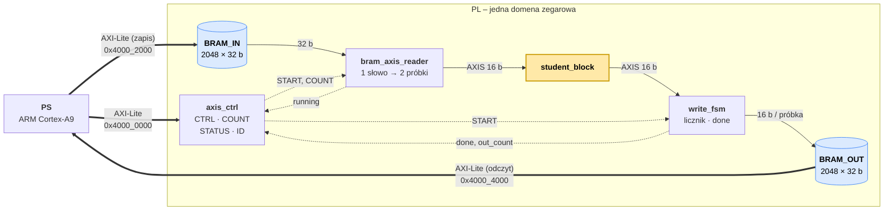

# RIM – otoczka testowa dla bloku studenta (Zynq-7000)

Otoczka pozwala przepuścić ramkę próbek z PS przez blok studenta i odczytać wynik.
Dane trafiają do pamięci przez AXI-Lite, bez DMA.



Linie ciągłe pokazują przepływ danych, a przerywane sygnały sterujące i statusowe. Żółty blok podmienia student.

## Mapa adresowa

| Blok | Adres bazowy | Rozmiar |
|---|---|---|
| `axis_ctrl_v3_0_0` (rejestry) | `0x4000_0000` | 4 KB |
| `bram_axil_in_0` (BRAM_IN) | `0x4000_2000` | 8 KB = 2048 słów = 4096 próbek |
| `bram_axil_out_0` (BRAM_OUT) | `0x4000_4000` | 8 KB = 2048 słów = 4096 próbek |

## Rejestry `axis_ctrl` (offset od `0x4000_0000`)

| Offset | Nazwa | Dostęp | Opis |
|---|---|---|---|
| `0x00` | CTRL | W | bit 0 = START (zapis `1` generuje impuls, bit sam się kasuje) |
| `0x04` | COUNT | R/W | liczba **próbek** (nie słów) do wysłania, 1…4096 |
| `0x08` | STATUS | R | bit 0 `running`, bit 1 `done`, bit 2 `overflow`, bity [15:4] `out_count` (liczba próbek wyniku) |
| `0x0C` | ID | R | `0xC0FFEE03` – sprawdzenie, czy wgrany jest właściwy bitstream |

## Format danych

Próbki są **16-bitowe**, po **dwie w jednym słowie 32-bit**. Młodsza połówka idzie pierwsza:

```
słowo k = (próbka[2k+1] << 16) | próbka[2k]
```

Przykład dla próbek `1, 2, 3, 4` w BRAM_IN: `0x00020001`, `0x00040003`.

W ten sam sposób spakowany jest wynik w BRAM_OUT. Interpretacja 16 bitów (unsigned czy signed U2) należy do studenta, bo otoczka przenosi surowe bity.

## Procedura uruchomienia

1. Zapisz spakowane próbki do BRAM_IN od `0x4000_2000`.
2. Zapisz liczbę próbek N do COUNT (`0x4000_0004`).
3. Zapisz `1` do CTRL (`0x4000_0000`).
4. Odpytuj STATUS (`0x4000_0008`), aż bit 1 (`done`) będzie równy `1`.
5. Odczytaj `out_count = (STATUS >> 4) & 0xFFF`, a następnie `ceil(out_count / 2)` słów z BRAM_OUT od `0x4000_4000`.

`done` pozostaje ustawione do następnego START. Kolejny START wydaj dopiero po `done`, bo w trakcie przetwarzania jest ignorowany.

## Przykład – XSDB (JTAG)

```tcl
connect
targets 2
stop
fpga -file <projekt>.runs/impl_1/<bd>_wrapper.bit
source /tmp/xsa/ps7_init.tcl          ;# unzip <bd>_wrapper.xsa -d /tmp/xsa
ps7_init
ps7_post_config

mrd -force 0x4000000C                 ;# ID -> C0FFEE03
mwr -force 0x40002000 {0x00020001 0x00040003 0x00060005 0x00080007 0x000A0009 0x000C000B 0x000E000D 0x0010000F}
mwr -force 0x40000004 16              ;# COUNT = 16 próbek
mwr -force 0x40000000 1               ;# START
mrd -force 0x40000008                 ;# STATUS -> 00000102 (done, out_count = 16)
mrd -force 0x40004000 8               ;# wynik (dla bloku +1: 00030002 00050004 ...)
```

## Interfejs bloku studenta

```verilog
module student_block (
    input  wire        clk, resetn,
    input  wire [15:0] s_axis_tdata,  input  wire s_axis_tvalid,
    output wire        s_axis_tready, input  wire s_axis_tlast,
    output wire [15:0] m_axis_tdata,  output wire m_axis_tvalid,
    input  wire        m_axis_tready, output wire m_axis_tlast
);
```

Wymagania:
- **Wejście** to N próbek. `s_axis_tlast` jest ustawiony przy ostatniej. Blok może wstrzymywać wejście, ustawiając `s_axis_tready = 0`.
- **Wyjście** może mieć dowolne opóźnienie i dowolną liczbę próbek (≤ 4096). Blok **musi** ustawić `m_axis_tlast` na ostatniej próbce wyniku. Bez tego `done` nigdy się nie pojawi.
- `m_axis_tready` jest zawsze równe `1`, ponieważ wyjście nie jest wstrzymywane. Każdy takt z `m_axis_tvalid = 1` to zapisana próbka.
- Cały system pracuje w jednej domenie zegarowej (`clk` = zegar AXI z PS), bez CDC.

## Ograniczenia i pułapki

- **Maksymalnie 4096 próbek** na wejściu i na wyjściu. Przy większym COUNT reader zaczyna czytać BRAM_IN od początku. Dłuższy wynik nadpisuje BRAM_OUT od początku, a flaga `overflow` się **nie** ustawia.
- **`out_count` = 0 oznacza 4096 próbek**, bo pole ma 12 bitów.
- **BRAM_OUT jest tylko do odczytu z PS.** Zapisy są przyjmowane, ale ignorowane, więc pamięci nie da się wyzerować przed testem. O tym, ile słów wyniku jest aktualnych, mówi tylko `out_count`.
- **Nieparzyste N:** ostatnie słowo wejścia ma używaną tylko młodszą połówkę. W ostatnim słowie wyniku starsza połówka zawiera dane z poprzedniego uruchomienia.
- **COUNT = 0:** reader nie startuje, a `write_fsm` czeka na `tlast`. `done` się nie pojawi, aż wydasz START z poprawnym COUNT.
- Po zmianach tylko w PL wystarczy wgrać nowy bitstream. `ps7_init` trzeba powtórzyć dopiero po zmianie konfiguracji PS.

## Pliki

| Plik (`hdl/`) | Rola |
|---|---|
| `axis_ctrl_v3_0.v` | rejestry CTRL/COUNT/STATUS/ID (AXI-Lite) |
| `bram_axil_in.v` | BRAM_IN: zapis z PS (AXI-Lite), odczyt przez reader (port natywny) |
| `bram_axis_reader.v` | BRAM_IN → AXI-Stream 16 bit, rozpakowuje 2 próbki ze słowa |
| `student_block.v` | blok studenta (przykład: `y = x + 1`) |
| `write_fsm.v` | AXI-Stream → BRAM_OUT, liczy próbki, ustawia `done` |
| `bram_axil_out.v` | BRAM_OUT: zapis z `write_fsm`, pakowanie 2 próbek w słowo, odczyt z PS |

## Budowanie projektu

Projekt Vivado **nie jest trzymany w repo**. W repo są tylko źródła i skrypty Tcl,
z których projekt odtwarza się w kilka minut.

### Wymagania

- **Vivado 2025.2** – na innej wersji skrypt BD może zgłosić inne wersje IP
  (wtedy *Tools → Report → Report IP Status → Upgrade*).
- Płytka **Digilent Cora Z7-10** (`xc7z010clg400-1`).
- Board files Cora Z7-10 są **opcjonalne**. Jeśli ich nie ma, skrypt wypisze ostrzeżenie
  i użyje samego partu. Konfiguracja PS7 jest w całości w `bd/rim_proj_hw.tcl`, więc wynik
  jest taki sam. Instalacja: Vivado → *Tools → Vivado Store → Boards → Cora Z7-10*.

### Krok 1 – pobranie repo

```bash
git clone https://github.com/TomaszZebala/RIM.git
cd RIM
```

### Krok 2a – utworzenie projektu (do pracy w GUI)

Linux (terminal, w katalogu repo):

```bash
source /tools/Xilinx/2025.2/Vivado/settings64.sh   # ścieżka zależy od instalacji
vivado -mode batch -source scripts/create_project.tcl
vivado build/rim_proj.xpr                          # otwiera gotowy projekt w GUI
```

Windows / bez terminala: uruchom Vivado → *Tools → Run Tcl Script…* →
wybierz `scripts/create_project.tcl`. Projekt otworzy się sam.

Skrypt tworzy projekt w `build/`, dodaje pliki z `hdl/`, odtwarza block design,
generuje wrapper i ustawia go jako top. Potem *Generate Bitstream* jak zwykle.

### Krok 2b – pełny build bez GUI

```bash
vivado -mode batch -source scripts/build.tcl
```

Tworzy projekt (jeśli go nie ma), robi syntezę, implementację, bitstream i eksportuje
platformę sprzętową:

| Wynik | Ścieżka |
|---|---|
| bitstream | `build/rim_proj.runs/impl_1/rim_proj_hw_wrapper.bit` |
| platforma (Vitis/XSDB) | `build/rim_proj_hw_wrapper.xsa` |

Trwa ok. 10–15 minut.

### Odtworzenie od zera

Skrypt `create_project.tcl` nie nadpisuje istniejącego projektu. Żeby zacząć od nowa,
usuń katalog `build/` i uruchom skrypt ponownie.

### Struktura repo

| Ścieżka | Zawartość |
|---|---|
| `hdl/` | źródła Verilog (moduły wstawiane do BD jako *module reference*) |
| `bd/rim_proj_hw.tcl` | block design zapisany jako Tcl (`write_bd_tcl`) |
| `scripts/create_project.tcl` | tworzy projekt w `build/` |
| `scripts/build.tcl` | synteza, implementacja, bitstream, eksport `.xsa` |
| `scripts/export_bd.tcl` | zapisuje zmieniony BD z powrotem do `bd/` |
| `build/` | generowany projekt Vivado, **ignorowany przez git** |

## Wprowadzanie zmian

**Kod Verilog (`hdl/`).** Projekt odwołuje się bezpośrednio do plików w `hdl/` (bez kopiowania
do `build/`), więc edycja w Vivado od razu zmienia pliki w repo. Wystarczy commit.

**Block design.** Zmiany w BD **nie** trafiają do repo automatycznie. Po zmianie, z otwartym
projektem, wpisz w konsoli Tcl Vivado (pełna ścieżka do repo):

```tcl
source /sciezka/do/RIM/scripts/export_bd.tcl
```

Skrypt nadpisze `bd/rim_proj_hw.tcl`. Potem commit tego pliku. Dobrze jest sprawdzić, czy
po usunięciu `build/` projekt odtwarza się poprawnie.

**Nowe pliki.** Nowy moduł `.v` wrzuć do `hdl/`. Skrypt dodaje wszystkie `*.v` z tego katalogu.
Ograniczenia `.xdc` wrzuć do `constrs/` (skrypt doda je, jeśli katalog istnieje).
